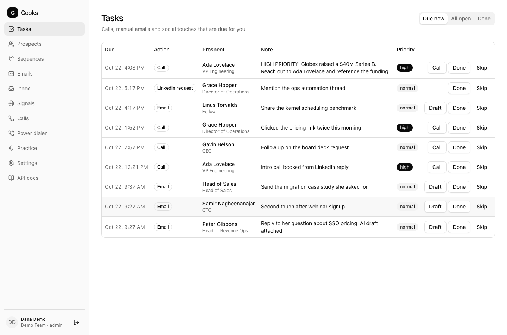
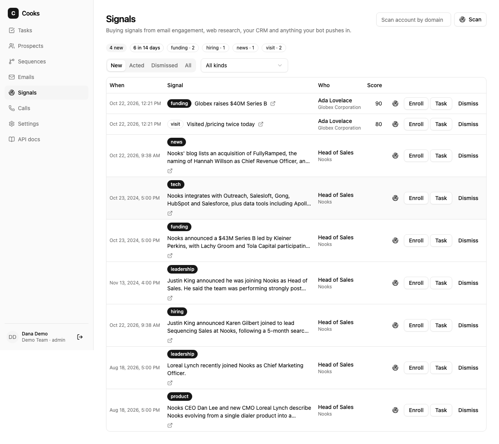
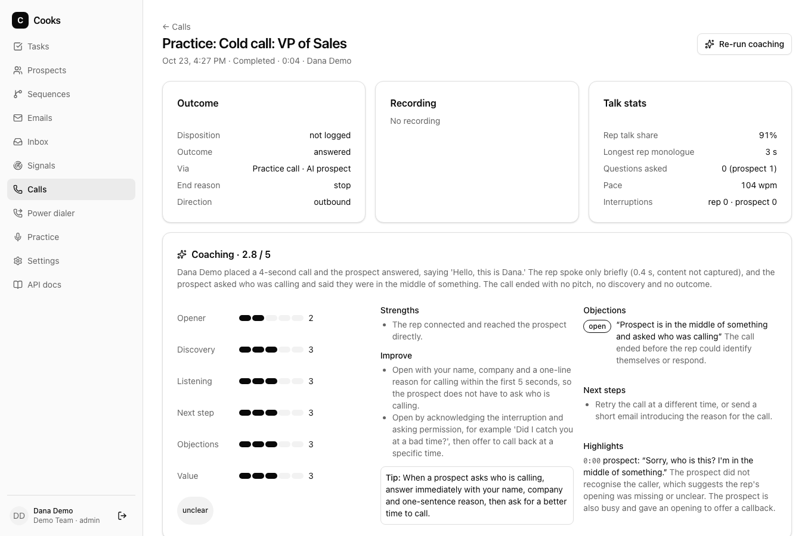

<p align="center">
  
</p>

<h1 align="center">Cooks</h1>

<p align="center">
  <strong>Open-source sales engagement. Let your reps cook.</strong><br>
  Sequences, a dialer, buying signals and call coaching on one Postgres, driven by the AI assistant you already pay for.
</p>

<p align="center">
  <a href="https://github.com/walter-grace/cooks/actions/workflows/ci.yml"></a>
  <a href="https://github.com/walter-grace/cooks/releases/latest"></a>
  <a href="LICENSE"></a>
  
</p>

<p align="center">
  <a href="#quick-start">Quick start</a> ·
  <a href="#connect-your-assistant">Connect your assistant</a> ·
  <a href="#what-you-get">Features</a> ·
  <a href="#how-it-works">How it works</a> ·
  <a href="#documentation">Docs</a> ·
  <a href="#fork-it">Fork it</a>
</p>

---

Cooks is the sales engagement stack a team would build for itself if it had the time: a sequencing engine with real send windows and reply detection, a Twilio dialer with recordings, a feed of buying signals, and an AI coach that scores every recorded call. It runs on your own server under the MIT license, and it speaks the same REST contract as the commercial platform it mirrors, so existing clients and docs carry over by changing a base URL.

The part that makes it different is the brain. Cooks ships an MCP server with 66 tools, so Claude, Grok, Cursor or any MCP-capable assistant can work your pipeline directly: research an account, enroll the prospect, draft the email, place the call, log the outcome. In that mode Cooks spends no tokens of its own.

## What you get

<table>
  <tr>
    <td width="50%" valign="top">
      <h3>Sequencing</h3>
      Multi-step email, call, LinkedIn and manual cadences. Per-prospect time zones, workspace send windows, daily caps and spacing per mailbox, merge fields with strict templates, A/B variants, reply and bounce detection, out-of-office handling, one-click unsubscribe. AI drafts on any email step, routed to a human when the model is unsure.
    </td>
    <td width="50%" valign="top">
      <h3>Dialer</h3>
      Reps call on Twilio Voice, from the browser or with a bridge that rings their phone first. A parallel power dialer rings three or four prospects at once and drops the first person who answers straight into the rep's ear, with no beep or message; machines are detected and hung up. With a speech recognizer configured it hears the pickup itself and connects on "Hello?" about a second in, instead of waiting three for carrier AMD; TypeSafe's Jev on OpenRouter can decide the unclear ones. Or let a Speko voice agent place the call from a script and bring back the outcome, transcript and recording. Dispositions close the linked task, a byte-compatible <code>call.logged</code> webhook fires, and calls land on the HubSpot timeline.
    </td>
  </tr>
  <tr>
    <td width="50%" valign="top">
      <h3>Signals</h3>
      One feed of buying signals from email engagement, web research, CRM changes, and anything your bot pushes in through the API. Rules turn matching signals into enrollments or tasks. Accounts in active sequences get a web scan every seven days.
    </td>
    <td width="50%" valign="top">
      <h3>Coaching</h3>
      Every recorded call is split by speaker, transcribed through any OpenAI-compatible speech-to-text endpoint, and scored on a six-part rubric: opener, discovery, listening, value, objections, next step. Talk ratio, monologues, questions asked, and one concrete tip per call.
    </td>
  </tr>
</table>

| Signals feed | Call coaching |
| --- | --- |
|  |  |

**Also in the box**

- A web app at `/app` built on shadcn/ui: task queue, prospects, accounts, sequences, emails, calls, power dialer, signals, settings. Light and dark.
- Gmail, Microsoft 365 and plain SMTP mailboxes, with inbound sync for replies and bounces.
- Inkbox as a channel: every rep or agent gets an email address, an SMS number and an iMessage line. Sequences send through them, replies come back through a signed webhook into one inbox, texts respect consent and quiet hours, and STOP opts the prospect out.
- HubSpot connector: contact and company sync, list and deal-stage auto-enroll, notes and email/call logging. Salesforce users run the Salesforce MCP next to the Cooks MCP in the same bot today.
- Hosted AI per workspace on Anthropic, xAI, OpenAI, OpenRouter or Ollama, with a run ledger that records tokens and cost.
- Workspace API keys and OAuth 2.1 with PKCE and dynamic client registration. Clerk SSO when you want it, where organizations become workspaces.
- Signed, retried webhooks for calls, emails, enrollments, tasks and prospects.

## Quick start

You need Node 22+, pnpm 9 and Postgres 15+. Mailpit is optional for catching email locally.

```bash
git clone https://github.com/walter-grace/cooks.git && cd cooks
pnpm install
createdb cooks
cp .env.example .env
pnpm bootstrap --email you@example.com --workspace "My Team" --password 'choose-one'
```

The bootstrap prints a workspace API key once. Then start the two processes and build the UI:

```bash
pnpm --filter @cooks/api dev      # API + web app on http://localhost:8080
pnpm --filter @cooks/worker dev   # sequence engine, mail, webhooks, AI jobs
pnpm web:build                    # builds the UI the API serves at /app
pnpm seed                         # optional demo data
```

Sign in at http://localhost:8080/app with the email and password you chose. API docs live at `/docs`.

**Calling with Twilio (optional)**

Paste your Account SID and Auth Token under Settings → Dialer, or set `TWILIO_ACCOUNT_SID`, `TWILIO_AUTH_TOKEN` and `TWILIO_FROM_NUMBER` in `.env`. Twilio has to reach your machine for call webhooks, so for local development run a tunnel and point `COOKS_PUBLIC_URL` at it:

```bash
ngrok http 8080                       # copy the https://….ngrok.app URL
COOKS_PUBLIC_URL=https://….ngrok.app pnpm --filter @cooks/api dev
```

Calling from the browser (and the power dialer's browser mode) additionally needs a Standard API key pair and a TwiML App whose Voice URL is `$COOKS_PUBLIC_URL/telephony/voice?ws=<workspace id>`; set `TWILIO_API_KEY_SID`, `TWILIO_API_KEY_SECRET` and `TWILIO_TWIML_APP_SID`. The parallel dialer also needs an admin to confirm the compliance mode once under Settings → Dialer. Everything runs without a Twilio account against `pnpm qa:mock-twilio` (see [docs/dialer.md](docs/dialer.md)).

**Docker**

```bash
export COOKS_KEK=$(node -e "console.log(require('crypto').randomBytes(32).toString('base64'))")
docker compose --profile dev up -d
docker compose run --rm api pnpm bootstrap --email you@example.com --workspace "My Team"
```

That brings up Postgres, the API on `:8080`, the worker, the MCP server on `:8081` and Mailpit on `:8025`. See [docs/self-host.md](docs/self-host.md) for production notes.

## Connect your assistant

The MCP server ships as a tarball on GitHub Releases. One command adds it to Claude Code:

```bash
claude mcp add cooks \
  -e COOKS_API_URL=http://localhost:8080 \
  -e COOKS_API_KEY=cooks-api-... \
  -- npx -y https://github.com/walter-grace/cooks/releases/latest/download/cooks-mcp.tgz
```

Create the key under Settings → API keys. Claude Desktop, Cursor and Grok setups, plus the hosted HTTP transport with OAuth for claude.ai connectors, are in [docs/mcp.md](docs/mcp.md).

Once connected, your assistant can say things like:

> "Find the three accounts with the strongest signals this week, enroll their champions in the Q4 sequence, and call the one who clicked twice."

and Cooks does the work with your rules, your mailboxes and your audit trail.

## How it works

```
apps/api       Hono + zod-openapi. Serves /v1, /openapi.yml, /docs, the web app at /app, and Twilio webhooks.
apps/worker    pg-boss consumers: enrollment engine, email send + sync, webhooks, signals, recordings, coaching.
apps/mcp       MCP server, stdio for local assistants and streamable HTTP for hosted connectors.
apps/web       React 19 + Vite + Tailwind v4 + shadcn/ui.
packages/core  Domain services shared by API, worker and MCP: sequencing, mail, telephony, signals, CRM.
packages/agent LLM providers, structured contracts, transcription, coaching, research.
packages/auth  API keys, passwords, sessions, ES256 signing keys, OAuth 2.1 server.
packages/db    Drizzle schema and migrations. UUIDv7 ids, keyset-cursor indexes, soft deletes.
spec/          Vendored upstream OpenAPI document and lock file for conformance checks.
```

Everything runs on a single Postgres. Jobs, rate limits, the webhook outbox and the MCP session store all live there, so there is no Redis or queue to operate.

The sequencing engine is a small state machine. An enrollment points at its current step. Advancing picks the next live step by order and schedules it at a time computed from the step interval, the prospect's time zone, the workspace send window and a seeded jitter. Manual steps become tasks, and completing or skipping the task advances the enrollment. Automatic email steps render through LiquidJS in strict mode and send through the owner's mailbox, honoring suppression lists, daily caps and spacing. A unique execution row per step and enrollment means a duplicate job delivery never sends twice.

Secrets that Cooks holds for you, such as mailbox credentials, provider keys, Twilio tokens and webhook signing keys, are encrypted at rest with a key you supply in `COOKS_KEK`. The API never returns them, only the last four characters.

## API compatibility

Cooks implements the public Sequencing API contract of the commercial platform it mirrors: paths, `{data}` envelopes, cursor paging, bracket filters, `include=`, error codes, scopes and rate-limit headers. The upstream document is vendored in `spec/` and a conformance script diffs our served spec against it in CI. Operations that only exist here, such as creating prospects or managing webhooks, are tagged as extensions in `/openapi.yml`.

Details and the list of deliberately mirrored behaviors are in [docs/api-compat.md](docs/api-compat.md).

## Documentation

| Topic | Guide |
| --- | --- |
| Self-hosting and configuration | [docs/self-host.md](docs/self-host.md) |
| Authentication, API keys, OAuth 2.1, Clerk SSO | [docs/auth.md](docs/auth.md) |
| MCP server and assistant setup | [docs/mcp.md](docs/mcp.md) |
| AI providers, hosted agents, guardrails | [docs/ai.md](docs/ai.md) |
| Dialer on Twilio, parallel dialing | [docs/dialer.md](docs/dialer.md) |
| Parallel dialing research notes | [docs/parallel-dialing-research.md](docs/parallel-dialing-research.md) |
| Signals and rules | [docs/signals.md](docs/signals.md) |
| Call coaching and transcription | [docs/coaching.md](docs/coaching.md) |
| HubSpot and CRM | [docs/crm.md](docs/crm.md) |
| Inkbox channels: email, SMS, iMessage, hosted calls | [docs/inkbox.md](docs/inkbox.md) |
| Webhooks and signatures | [docs/webhooks.md](docs/webhooks.md) |
| API compatibility and conformance | [docs/api-compat.md](docs/api-compat.md), [docs/conformance.md](docs/conformance.md) |

## Fork it

Cooks is meant to be forked. The service layer in `packages/core` is the one place business rules live, and the API, worker and MCP server all call it in process, so a change there shows up everywhere at once. A few starting points:

- **New channel or step type.** Add the action to the step enum in `packages/db`, teach the engine in `packages/core` how to execute it, and expose it as an MCP tool.
- **New signal source.** Call `pushSignal` from a worker job or post to `POST /v1/signals` from anywhere. Rules already know how to act on it.
- **New CRM.** Implement the connector interface next to the HubSpot one.
- **Different model.** Providers are pluggable. Point a workspace at Ollama and run fully offline.

Development commands:

```bash
pnpm test          # vitest; database tests run on PGlite, no Docker needed
pnpm typecheck
pnpm conformance   # diff /openapi.yml against the vendored upstream spec
```

Contributions are welcome. Read [CONTRIBUTING.md](CONTRIBUTING.md) first, and report security issues as described in [SECURITY.md](SECURITY.md).

## License

MIT. See [LICENSE](LICENSE).

Cooks is an independent open-source project built from public documentation. It is not affiliated with, endorsed by, or supported by Nooks. Research notes in `docs/research` are compiled from public sources.
