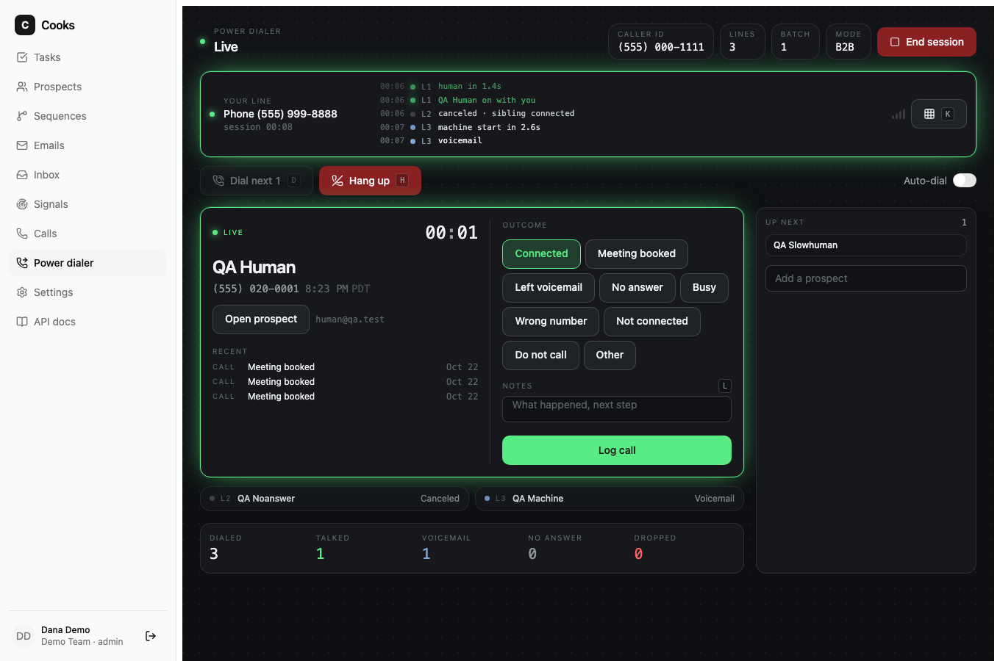

# Dialer

Cooks has two dialer providers. **Twilio** carries calls a rep makes (phone bridge, browser
softphone, or the parallel power dialer). **Speko** and **Dial** place AI-voiced calls: a voice agent dials the prospect, follows your
script, and the outcome, transcript, summary, cost and recording land in Cooks. Both can be
connected at once; an admin picks which one the Call button uses under Settings → Dialer.
Every provider sits behind the same interface (`packages/core/src/dialer/providers`): place,
get, recording, hangup.

## Twilio

Cooks places and records calls through your own Twilio account. Two modes:

| Mode | Needs | How it works |
| --- | --- | --- |
| **Bridge** | Account SID + Auth Token, one Twilio number | Twilio rings the rep's phone first; when they pick up it dials the prospect and bridges the legs. Works from any phone, no browser audio. |
| **Softphone** | Bridge requirements + an API key pair + a TwiML App | The rep calls from the browser (Twilio Voice SDK). Twilio asks Cooks for TwiML at the app's voice URL. |

Both modes record dual-channel audio (rep on the left, prospect on the right), which is what makes
speaker-labelled transcripts and talk-ratio stats possible (see `docs/coaching.md`).

## Connect Twilio

1. Twilio Console → Account → copy the **Account SID** and **Auth Token**.
2. Buy or pick a voice-capable number.
3. Cooks → Settings → Dialer → paste SID and token. Cooks verifies them and lists your numbers.

For browser calling also:

4. Console → Account → API keys & tokens → create a **Standard** API key; keep the SID and secret.
5. Console → Voice → TwiML Apps → create one with **Voice request URL** set to
   `https://<your cooks host>/telephony/voice?ws=<workspace id>` (POST). The workspace id is shown in
   Settings → Dialer.
6. Paste the API key SID, secret and the TwiML App SID into Settings → Dialer.

Cooks must be reachable from Twilio for status, recording and TwiML callbacks. For local
development use a tunnel (`ngrok http 8080`, Cloudflare Tunnel) and set `COOKS_PUBLIC_URL` to it.
Every callback is verified with `X-Twilio-Signature` against your auth token.

## Parallel dialing (power dialer)

The power dialer at `/app/dialer` rings several prospects at once and connects the first person who
answers to the rep, with no beep, announcement or AI voice. It is the flow the commercial parallel dialers sell, built on
Twilio Programmable Voice and Twilio's asynchronous answering-machine detection (AMD).



The page is an instrument console: your own line in a rail at the top (a live scope and link quality
when you join from the browser, a console ticker of line events in either mode), one channel per
line with an LED that ripples while ringing and the AMD verdict latency once it lands, and the
connected line expanded into a caller-ID dossier (formatted number, flag, area-code region, local
time with a quiet-hours flag, recent emails, calls and signals) beside the log form. Keyboard:
<kbd>D</kbd> dial, <kbd>H</kbd> hang up, <kbd>M</kbd> mute, <kbd>K</kbd> keypad, <kbd>L</kbd> notes.

How a batch works:

1. **The rep joins first.** From the browser (Voice SDK, needs the API key pair and TwiML App) or by
   phone (Twilio rings the rep, who lands in a silent conference). Nothing is dialed until the rep is in
   the room.
2. **Cooks dials N lines** (default 3, admin-set cap, 1–6) with `calls.create`, `MachineDetection=Enable`
   and `AsyncAmd=true`. A leg that answers hears silence (`<Pause>`) while the verdict is reached. With a
   recognizer configured, the same TwiML also forks the callee's audio to the speech gate (below), which
   usually calls it first.
3. **First human wins.** The verdict that says `human`, whether it came from the speech gate or the AMD
   callback, claims the session with one `UPDATE … WHERE connected_line_id IS NULL` statement. Only one such
   update can return a row, so two simultaneous humans can never both reach the rep. A line takes exactly one
   verdict: `UPDATE dial_lines … WHERE answered_by IS NULL`, so the slower detector is a no-op. The winner is redirected into the conference
   (`beep="false"`), a dual-channel recording starts on the rep's leg, and in the same moment every sibling
   is handled: still ringing → canceled silently; already answered → dropped (see compliance).
4. **Losers become callbacks.** A second human is hung up and a high-priority call task due in 15 minutes
   is created for the rep, noting the dropped call. Machines (`machine_*`), faxes and `unknown` verdicts
   are hung up, never connected; machine and no-answer legs are logged automatically as No answer or Busy,
   which completes their sequence tasks.
5. **Wrap and repeat.** When the prospect leaves, the session is `wrapping`: the rep logs the call (same
   dialog as any other call) and dials the next batch. With auto-dial on, a batch that ends with nobody
   connected rings the next one by itself. The rep leaving the room ends the session; sessions idle for two
   hours are closed by the worker.

Every carrier webhook is recorded in `dial_events` under a unique key before it is acted on, so Twilio
retrying a callback changes nothing. All parallel webhooks are signature-checked like the rest.

### Compliance mode (required)

Dropping a person who answered is an **abandoned call** under the FTC Telemarketing Sales Rule
(16 CFR 310.4(b)(1)(iv)) when the callee is a consumer. Before the first session an admin must choose a
mode under Settings → Dialer and confirm it:

| Mode | Rules Cooks applies |
| --- | --- |
| **B2B** | Up to 6 lines. Dropped humans still get a callback task. Business-to-business calls are largely exempt from the rule (310.6(b)(7)). |
| **Consumer** | At most 2 lines. An abandoned-call message (your name and number) is required and is played to a dropped person before the hangup, as 310.4(b)(4)(iii) requires. Cooks tracks the 30-day abandonment rate (dropped ÷ answered by a person) and falls back to one line per batch while it is at or above the 3% safe harbor. |

In both modes prospects on the do-not-call list (do-not-contact flag or a Do-not-call disposition), without a
phone number, or outside 08:00–21:00 in their time zone are skipped with the reason shown. Ring timeout is
25 s by default (15–60; the rule asks for at least 15 s or four rings). None of this is legal advice;
the TCPA and state rules apply on top.

### Fast pickup (speech gate)

Carrier AMD listens for about 2.4 s of speech and then a pause before it will say "human". A person who
answers says "Hello?" and is done in 600 ms; every second of silence after that is a second in which they
hang up. The speech gate closes that gap. When a leg answers, the hold TwiML adds
`<Start><Stream track="inbound_track">` so Twilio forks the callee's audio (8 kHz μ-law, 20 ms frames) to
`wss://<PUBLIC_URL>/telephony/parallel/stream`. Cooks measures the voice (when speech started, how long the
run is, the silence after it, a 1 kHz beep), streams the frames to a recognizer, and decides:

| What it hears | Verdict | Typical time after pickup |
| --- | --- | --- |
| A short greeting ("Hello?", "Yeah, this is Sam") then ≥ 350 ms of silence | person, connected | 0.9–1.3 s |
| "you've reached", "leave a message", "press one", 40 more voicemail and IVR phrases | machine, hung up and logged | the moment the phrase lands, ~1 s |
| Speech that runs 2.6 s with no pause, or a beep | machine | 2.6 s |
| A bare name or company ("Dana Lee") | person at low confidence, or **Jev** decides when enabled | 1.2 s |
| Nothing usable for 6 s | no verdict; AMD decides | |

AMD keeps running beside it as the fallback, and `unknown` from the gate never settles anything. The
connected line shows which detector won ("person (heard) in 1.1s" vs "(AMD) in 3.2s") and the first words,
which are also kept on the line (`speech.text`) as evidence. No audio is stored; the socket is closed the
instant a verdict exists.

**Jev.** [TypeSafe's Jev](https://openrouter.ai/docs/guides/community/jev) on OpenRouter is a decision
model: it takes state plus a typed question and returns a choice with probabilities in a few hundred
milliseconds, with free output tokens. When an admin picks "Rules, with Jev deciding unclear pickups", the
gate sends the transcript and timing of an ambiguous pickup to the Decisions API (`typesafe/jev-1.14`) with
one Choice question (human / voicemail / ivr / unclear) and takes the answer; rules decide if Jev is slow
(700 ms cap) or unreachable. Needs `OPENROUTER_API_KEY`; about $0.00002 per question.

**Recognizers** (`SPEECH_PROVIDER`):

| Provider | Setting | Notes |
| --- | --- | --- |
| `openai` | `SPEECH_API_KEY` (or `OPENAI_API_KEY`), optional `SPEECH_MODEL` (default `gpt-live-transcribe`) | OpenAI Realtime transcription over WebSocket; audio resampled to 24 kHz. Written to the published guide, not yet run against a live account from this repo. |
| `sherpa` | `SPEECH_MODEL_DIR` pointing at a sherpa-onnx streaming transducer (encoder/decoder/joiner `.onnx` + `tokens.txt`), plus `pnpm --filter @cooks/api add sherpa-onnx-node` | Fully local. NVIDIA's Nemotron Speech streaming model (80 ms chunks) or a Zipformer; sherpa-onnx is Apache-2.0. Written to the package's JS API, not yet run against a downloaded model here. |
| `mock` | none | Scripted transcript for QA with `scripts/qa/mock-twilio.mjs`. |
| `off` | | Default. Lines wait for AMD. |

Settings → Dialer → "Fast pickup" turns the gate off, on with rules, or on with Jev, per workspace. The
gate only ever hears the first seconds of a leg that has not yet been connected to anyone, the same window
AMD listens to.

### AMD tuning

Settings → Dialer exposes Twilio's knobs with these defaults: analysis timeout 5 s, speech threshold
2400 ms, speech-end threshold 1200 ms, silence timeout 3000 ms, and `unknown` → hang up. Twilio's own
guidance for the shortest wait is a speech threshold of 1800–3000 ms and a speech-end threshold of
1400–1500 ms. Expect one to four seconds between the prospect's hello and the bridge; that gap is the
cost of never connecting a voicemail.

### Trying it without Twilio

```bash
pnpm qa:mock-twilio                     # :18100, auth token qa-auth-token
TWILIO_API_BASE=http://127.0.0.1:18100 pnpm --filter @cooks/api dev
TWILIO_API_BASE=http://127.0.0.1:18100 pnpm --filter @cooks/worker dev
```

Connect Twilio in Settings → Dialer with any Account SID and the token `qa-auth-token`, confirm B2B mode,
then open the power dialer in phone mode. The mock picks a scenario from the last digit of each
prospect's number: `…1` human, `…2` answering machine, `…3` no answer, `…4` busy, `…5` slow human.
Start the API with `SPEECH_PROVIDER=mock` as well and each answered leg forks synthetic line audio plus a
scripted transcript to the speech gate, so the human line connects on "Hello?" about a second after pickup
while the mock's AMD verdict only lands at three; `QA_EXPECT_SPEECH=1 pnpm qa:parallel` asserts it.

### API and tools

| Method | Path | Purpose |
| --- | --- | --- |
| GET/PUT | `/v1/workspace/dialer/compliance` | Mode, confirmation, lines, AMD tuning, abandonment rate |
| POST | `/v1/dialSessions` | Start a session (`repMode`, `repPhone`, `maxLines`, `autoDial`, `prospectIds`, `taskIds`) |
| GET | `/v1/dialSessions`, `/v1/dialSessions/current`, `/v1/dialSessions/{id}` | Sessions and live line status |
| PATCH | `/v1/dialSessions/{id}` | Auto-dial, lines per batch |
| POST | `/v1/dialSessions/{id}/actions/queue` | Add prospects or call tasks |
| POST | `/v1/dialSessions/{id}/actions/dial` | Ring the next batch |
| POST | `/v1/dialSessions/{id}/actions/hangup` | End the live conversation, stay in the room |
| POST | `/v1/dialSessions/{id}/actions/end` | End the session |
| POST | `/telephony/parallel/{rep/voice,rep/status,conference,prospect/voice,prospect/amd,prospect/status}` | Twilio webhooks (signed) |

MCP: `cooks_start_dial_session`, `cooks_dial_next_batch`, `cooks_dial_session_status`,
`cooks_hangup_dial_line`, `cooks_end_dial_session`, then `cooks_log_call` with the connected line's
`callId`. Research notes and the sources behind the design are in
[parallel-dialing-research.md](parallel-dialing-research.md).

## Speko (AI calls)

1. Create an API key at platform.speko.ai and paste it under Settings → Dialer → Speko. Cooks
   verifies it, stores it encrypted with `COOKS_KEK`, and lists your Speko numbers. Setting
   `SPEKO_API_KEY` on the server lets workspaces connect without pasting a key.
2. Pick a caller id. Numbers can be searched by area code and bought from the settings page.
   Buying is paid (setup fee plus a monthly rental on your Speko balance), so it always asks an
   admin to confirm the quoted price first.
3. Set the default script (instructions and opening line, with `{{ prospect.firstName }}`,
   `{{ account.name }}`, `{{ owner.name }}`, `{{ workspace.name }}` merge fields), the maximum
   length (hard ceiling 600 seconds) and the daily spend cap.

Place a call from a prospect page (AI call), a call task, the Calls page, or `cooks_place_ai_call`.
A successful request means the call is **queued**, not answered. The worker polls Speko every
10 seconds (or sooner when Speko's `call.status` webhook hits `/telephony/speko/webhook?ws=<workspace id>`,
verified with the Standard Webhooks signature when a secret is stored) until the call ends, then:

- stores the outcome (`answered`, `voicemail`, `no_answer`, `failed`), end reason, duration,
  cost, summary and the speaker-labelled transcript on the call;
- streams the recording through `GET /v1/calls/{id}/recording` (the signed Speko URL is never
  exposed);
- logs a disposition (Connected, Left voicemail, No answer, Not connected), which completes the
  linked call task, advances the sequence, fires `call.logged` and writes to HubSpot;
- queues AI coaching on the transcript when enabled.

Safety checks run before any request reaches Speko:

| Check | Behaviour |
| --- | --- |
| Do not call | Prospects flagged do-not-contact or with a Do-not-call disposition are refused (`DO_NOT_CALL`). |
| Quiet hours | Calls only go out 08:00 to 21:00 in the prospect's zone (prospect → account → owner → workspace). Refusals carry the next window (`QUIET_HOURS`). |
| Duration | `maxDurationSeconds` is capped at 600 whatever the request says. |
| Spend | Today's Speko cost plus an estimate for calls in flight must stay under the workspace cap (`SPEND_CAP`). |
| Credentials | API keys are held in memory per request and never written to logs, errors or responses. |

Speko error codes are translated into rep-facing messages (`INSUFFICIENT_CREDITS`,
`PHONE_NUMBER_KYB_ACCESS_SUSPENDED`, `PHONE_NUMBER_CONSENT_REQUIRED`,
`PHONE_NUMBER_PROVISIONING_CREDITS_REQUIRED`, price confirmation codes) and the original code is
returned in the error details so a bot can branch on it.

`scripts/qa/mock-speko.mjs` stands in for the Speko API locally (`SPEKO_API_BASE=http://127.0.0.1:18200`,
key `sk_live_qa`): sessions auto-play to a finished call with a transcript and recording.

## Dial (AI calls from an agent phone number)

[Dial](https://getdial.ai) gives an agent a real phone number with calls, SMS, WhatsApp and
iMessage, provisioned from a CLI in minutes. Cooks uses it the same way it uses Speko: a voice
agent places the call from your script and the transcript lands on the call record.

1. Sign up with the Dial CLI (`npm i -g @getdial/cli`, `dial auth login you@example.com`) or on
   getdial.ai, then paste the API key (`sk_live_…`, also `dial auth rotate-key`) under
   Settings → Dialer → Dial. Cooks verifies it against the account, stores it encrypted with
   `COOKS_KEK` and lists the numbers that can place calls. `DIAL_API_KEY` on the server lets
   workspaces connect without pasting a key.
2. Pick a caller id, or click **Get a number** on the Dial card. Dial picks a free US number,
   in the area code you give when it can. Buying is paid, admin-only, and needs an explicit
   confirm plus the account holder's consent, which Dial stores on the number. Numbers bought in
   the Dial dashboard or with `dial number purchase` show up too.
3. Set the script, length and daily cap as for Speko. Dial takes one prompt per call, so the
   opening line and the voicemail rule are folded into the instruction. Calls run 60 to 600
   seconds (Dial's own floor is 60; free accounts are cut at 300 by Dial), and `voice` is
   `male` or `female`.

Placement, polling, the safety checks and the disposition flow are identical to Speko
(`POST /v1/calls/actions/aiCall`, `cooks_place_ai_call`, `telephony.ai_poll`). Differences:

- Dial reports no per-call cost, no summary and no recording, so those fields stay empty and
  the daily spend cap is enforced on the running estimate only. Balance comes from
  `GET /v1/workspace/telephony/dial/balance` (Dial's prepaid credit).
- There is no answering-machine detection; a completed call with no prospect speech is stored
  as `no_answer`.
- Hangup cancels a queued or ringing call (not charged) or ends a live one; the call is stored
  as `failed` with end reason `canceled`.
- Free Dial accounts allow two concurrent calls, so the parallel dialer stays on Twilio. Dial's
  self-hosted audio mode (raw call audio over a websocket) could carry it later; see the
  research note in the launch kit.

Each prospect can carry its own call script (the **Call script** card on the prospect page, stored
as `crmCustomFields.aiCallScript` with `firstMessage` and `systemPrompt`). For Speko and Dial alike
the order is: the script sent with the call, then the prospect's script, then the workspace default.

Every call placed carries an `Idempotency-Key` of `cooks-<call id>`, so a retried request never
dials twice. Dial error codes (`insufficient_credit`, `unsupported_region`, `calling_disabled`,
`call_limit_reached`) are translated into rep-facing messages with the original code in the
error details.

## Calling

- **From a task**: call steps in sequences show a Call button; logging the call completes the task
  and advances the enrollment.
- **From a prospect page** or the Calls page: pick bridge or softphone.
- **From a bot**: `cooks_dial` (bridge), then `cooks_log_call`; or `cooks_place_ai_call` and
  `cooks_get_call_transcript` for Speko. `cooks_dialer_balance` shows credits and today's spend.
- **Without Twilio**: `POST /v1/calls` / `cooks_record_call` logs calls made elsewhere so the task
  queue, CRM and webhooks still see them.

Dispositions default to Connected, Meeting booked, Left voicemail, No answer, Busy, Wrong number,
Not interested, Call back later, Do not call. Add more with `POST /v1/callDispositions`.

## What logging a call does

`POST /v1/calls/{id}/actions/log` with an `outcome` or disposition:

1. stores disposition, notes and duration on the call;
2. completes the linked task (call steps);
3. emits `call.logged` with the upstream payload (`callData` with `userData`, `prospectData`,
   `accountData`, `disposition`, `sequenceData`, `recordingUrl`…), so webhook receivers written for
   the commercial API work unchanged;
4. writes a call engagement to HubSpot with duration, disposition and notes when the CRM is connected.

## API

| Method | Path | Purpose |
| --- | --- | --- |
| GET/PUT/PATCH/DELETE | `/v1/workspace/telephony` | Connection, caller ids, record/transcribe/coach toggles |
| POST | `/v1/telephony/token` | Voice SDK access token for the signed-in user |
| POST | `/v1/calls/actions/dial` | Start a call (`mode: bridge | softphone`) |
| POST | `/v1/calls` | Log a call made elsewhere |
| POST | `/v1/calls/{id}/actions/log` | Disposition + notes |
| GET | `/v1/calls/{id}/recording` | Stream the recording (proxied, authenticated) |
| GET | `/v1/calls/{id}/insights` | Transcript, stats, coaching |
| POST | `/v1/calls/{id}/actions/coach` | Re-run transcription/coaching |
| POST | `/telephony/voice`, `/telephony/voice/bridge`, `/telephony/status`, `/telephony/recording` | Twilio webhooks (signed) |
| GET | `/v1/workspace/dialer` | Both connections and the chosen provider |
| PUT | `/v1/workspace/dialer/provider` | Choose `twilio`, `speko` or `dial` |
| GET | `/v1/workspace/dialer/balance` | Balance and spend on whichever AI dialer is active |
| PUT/PATCH/DELETE | `/v1/workspace/telephony/dial` | Dial key, script, caps, caller id |
| GET | `/v1/workspace/telephony/dial/balance`, `…/dial/numbers` | Dial credit, spend today, cap; numbers on the account |
| POST | `/v1/workspace/telephony/dial/numbers` | Buy a Dial number, optional `areaCode` (admin, `confirm: true`, `consent: true`) |
| GET | `/v1/workspace/telephony/numbers/available` | Local Twilio numbers for sale with the monthly price |
| POST | `/v1/workspace/telephony/numbers` | Buy a Twilio number (admin, `confirm: true`) |
| PUT/PATCH/DELETE | `/v1/workspace/telephony/speko` | Speko key, script, caps, caller id |
| GET | `/v1/workspace/telephony/speko/balance` | Credits, spend today, cap |
| GET/POST | `/v1/workspace/telephony/speko/numbers`, `…/numbers/available` | Owned numbers, search, buy (admin, `confirm: true`) |
| POST | `/v1/calls/actions/aiCall` | Place an AI call (202 = queued) |
| POST | `/v1/calls/{id}/actions/hangup` | End a running AI call |
| GET | `/v1/calls/{id}/transcript` | Outcome, summary, cost, transcript |
| POST | `/telephony/speko/webhook?ws=` | Speko `call.*` events (Standard Webhooks signature) |

Environment: `TWILIO_API_BASE` and `SPEKO_API_BASE` point the clients at `scripts/qa/mock-twilio.mjs` and `scripts/qa/mock-speko.mjs` for local QA; `SPEKO_API_KEY` is an optional server-wide key; `DIAL_API_KEY` and `DIAL_API_BASE` do the same for Dial.

## Buying numbers

Every provider can sell you a number from Settings → Dialer:

- **Twilio**: the "Get a Twilio number" card searches local numbers that can place calls, by
  area code, and shows Twilio's monthly price for a local number.
- **Speko**: search by area code on the Speko card; the setup and monthly price come back with
  each number.
- **Dial**: "Get a number" on the Dial card; Dial chooses the number and bills it at your plan's
  per-number rate.

Buying is always paid, so only admins can do it and the API refuses without `confirm: true`. The
new number joins the caller ids and becomes the default. The MCP server has no tool that buys
numbers, so an assistant cannot spend money this way.

## Privacy

Recordings stay in your Twilio account; Cooks stores the recording SID and streams audio through
the API with your credentials. Delete the recording in Twilio (or disable recording in Settings)
to stop retaining it. Check call-recording consent rules for the regions you call.
